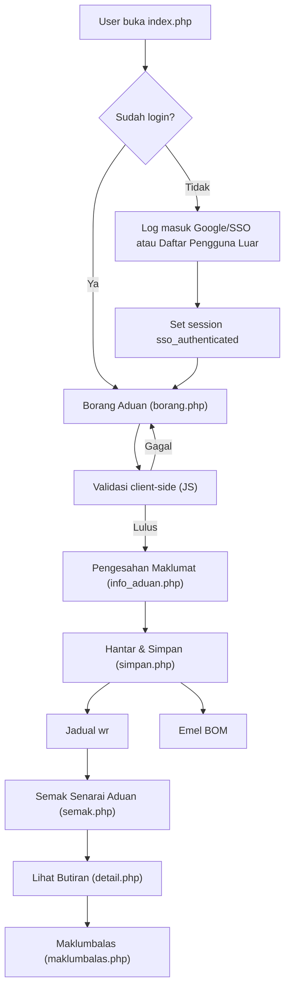

## e-Aduan v3 – Aliran Proses Aduan

Dokumen ini fokus kepada **flow aduan** dari perspektif pengguna dan bagaimana ia dipetakan kepada fail & jadual dalam sistem.

---

### 1. Gambaran Umum Flow

Secara ringkas, aliran proses:

1. **Log masuk** (staf / pelajar / pengguna luar)
2. **Isi borang aduan**
3. **Pengesahan maklumat aduan**
4. **Simpan ke jadual `wr` + hantar e-mel**
5. **Semak status & butiran aduan**
6. **Maklum balas selepas kerja siap**

Rajah aliran ringkas:

---

### 2. Langkah 1 – Log Masuk

**Fail utama**: `index.php`, `auth/*.php`, `pages/daftar_luar.php`, `includes/auth_guard.php`

1. Pengguna akses `index.php`.
2. Jika `$_SESSION['sso_authenticated']` sudah benar:
   - Terus redirect ke `pages/borang.php`.
3. Jika belum:
   - Papar UI login:
     - “Log masuk dengan Google” → `auth/google_callback.php?type=staf|student`
     - “Pengguna Luar” → `pages/daftar_luar.php`
4. **Pengguna Luar**:
   - Isi No K/P, nama, telefon, e-mel.
   - Sistem semak IC di `afm_user_osd`:
     - Jika ada: guna data sedia ada.
     - Jika tiada: `INSERT` rekod baru.
   - Set sesi:
     - `sso_authenticated = true`
     - `requestor = '3'`, `no_kp = ic_no`, `user_type = 'luar'` dll.
   - Redirect ke `pages/borang.php`.

**Guard Akses**:

- `includes/auth_guard.php` digunakan di halaman yang memerlukan login:
  - Jika `sso_authenticated` kosong → redirect ke `index.php`.
  - Jika `token_exp` telah luput → `session_destroy()` dan redirect ke `index.php?expired=1`.

---

### 3. Langkah 2 – Isi Borang Aduan (`pages/borang.php`)

**Tujuan**: Kumpul semua maklumat aduan daripada pengguna.

#### 3.1 Maklumat Pelapor (Seksyen 1.0)

- Berdasarkan `$_SESSION['requestor']`:
  - `1` – Staf:
    - Guna jadual `em`, `emstd`, `dp` untuk bina:
      - Nama staf, jawatan, jabatan, no ruang, no telefon pejabat/bimbit, e-mel.
  - `2` – Pelajar:
    - Guna jadual `stu`, `fakulti`, `site`.
  - `3` – Pengguna luar:
    - Guna jadual `afm_user_osd`.
- Papar dalam kad “1.0 Maklumat Pelapor” sebagai **read-only**.

#### 3.2 Lokasi Kerosakan

**Kebergantungan**: `location`, `infra`.

- **Jika staf (`requestor = '1'`)**:
  - Radio:
    - `location = 8` – **Bilik Sendiri**
      - Auto-isi dari jadual `em`:
        - `bl_id`, `fl_id`, `rm_id` → join ke `bl`, `fl`, `rm`, `state`, `site`, `bldg`.
      - Jika staf ada **lebih daripada satu bilik**:
        - Papar butang `Pilih Bilik Sendiri` (popup `bilik_sendiri.php`).
    - `location = 9` – **Lokasi Lain**
- **Jika pelajar / pengguna luar**:
  - Sistem set `location = 9` secara automatik (tiada pilihan bilik sendiri).

**Lokasi Lain (`location = 9`)**:

- Radio `infra`:
  - `1` – Dalam Bangunan
  - `2` – Luar Bangunan
- Dropdown bertingkat (AJAX):
  1. Negeri – `ajax/get_negeri.php`
  2. Kampus – `ajax/get_kampus.php?idnegeri=...`
  3. Bangunan – `ajax/get_bangunan.php?idkampus=...`
  4. Blok – `ajax/get_blok.php?idbangunan=...`
  5. Jika **Dalam Bangunan (infra = 1)**:
     - Aras – `ajax/get_aras.php?idblok=...`
     - Ruang – `ajax/get_ruang.php?idfloor=...&idblok=...`
  6. Jika **Luar Bangunan (infra = 2)**:
     - Kategori Infra – `ajax/get_kat_infra.php`
     - Sub Kategori – `ajax/get_sub_infra.php?idkat_infra=...`
- **Keterangan Lokasi**:
  - Textarea wajib diisi (`loc_desc`).

#### 3.3 Jenis Kerosakan

- Dropdown:
  - Seksyen (`section`) – `ajax/get_seksyen.php?idkampus=...&infra=...`
  - Elemen (`prob_group`) – `ajax/get_elemen.php?section=...&idkampus=...`
  - Masalah (`prob_type`) – `ajax/get_masalah.php?prob_group=...&idkampus=...`
- **Keterangan Kerosakan** (`prob_description`) – textarea wajib.

#### 3.4 Peta (Infra Luar Bangunan)

- Jika `infra = 2` (Luar Bangunan):
  - Papar Leaflet map.
  - Input `koordinat_lokasi` (readonly) diisi apabila:
    - Pengguna klik di peta, atau
    - Drag marker ke lokasi yang betul.
  - Jika ada nilai sedia ada (contoh dari sesi sebelumnya) → guna sebagai titik permulaan.
  - Jika tidak:
    - Cuba `navigator.geolocation`.
    - Jika gagal → fallback ke koordinat default (UiTM Shah Alam).

---

### 4. Validasi Client-side (JS) sebelum Langkah 3

**Lokasi**: `pages/borang.php` – fungsi `validateAndSubmit()`.

Tujuan: Pastikan **semua input yang diperlukan telah dipilih / diisi** sebelum:

- Menukar `form.action` ke `pages/info_aduan.php`
- Memanggil `form.submit()`

Ringkasan logik:

1. Buang kelas `.is-invalid` dan mesh alert lama.
2. Semak keperluan asas:
   - Staf (`requestor = '1'`):
     - `location` mesti dipilih.
   - Lokasi Lain:
     - `infra` mesti dipilih.
3. **Jika `location = 8` (Bilik Sendiri)**:
   - Pastikan bilik dipilih (`blk` tidak kosong).
   - Wajib:
     - `section`, `prob_group`, `prob_type`
     - `loc_desc`, `prob_description`
4. **Jika `location = 9` & `infra = 1` (Dalam Bangunan)**:
   - Wajib dropdown:
     - `idnegeri`, `idkampus`, `idbangunan`, `idblok`, `idfloor`, `idrm`
   - Wajib:
     - `section`, `prob_group`, `prob_type`
     - `loc_desc`, `prob_description`
5. **Jika `location = 9` & `infra = 2` (Luar Bangunan)**:
   - Wajib dropdown:
     - `idnegeri`, `idkampus`, `idbangunan`, `idblok`
     - `idkat_infra`, `id_subinfra`
   - Wajib:
     - `section`, `prob_group`, `prob_type`
     - `loc_desc`, `prob_description`
     - `koordinat_lokasi` (mesti ada; jika kosong → paksa pengguna tandakan peta).
6. Jika ada ralat:
   - Papar `alert` merah dalam `#validation-alert-wrap` dengan senarai ralat.
   - Tambah `.is-invalid` pada field yang bermasalah.
   - Scroll ke field pertama yang invalid.
7. Jika tiada ralat:
   - Set `form.action = baseUrl()/pages/info_aduan.php`.
   - `form.submit()`.

---

### 5. Langkah 3 – Pengesahan Maklumat (`pages/info_aduan.php`)

**Tujuan**: Beri peluang pengguna menyemak semula semua data sebelum simpan ke DB.

Proses:

1. Terima semua field dari `POST`:
   - Maklumat pelapor (dari sesi / hidden input).
   - Lokasi: `location`, `infra`, `idnegeri`, `idkampus`, `idbangunan`, `idblok`, `idfloor`, `idrm`, `idkat_infra`, `id_subinfra`.
   - Bilik sendiri: `neg`, `kamp`, `bang`, `blk`, `fl`, `ruang` + label nama (idneg, idkamp, idbang, idblk, idfl, idruang).
   - Kerosakan: `section`, `prob_group`, `prob_type`, `prob_description`, `loc_desc`.
   - Peta: `koordinat_lokasi`.
   - Medium: `medium`.
2. Resolve ID kepada nama:
   - Lokasi:
     - `state`, `site`, `bldg`, `bl`, `fl`, `rm` (atau `wr_kat_infra`, `WR_SUB_INFRA`).
   - Kerosakan:
     - `section`, `prob_group`, `probtype`.
3. Papar ringkasan:
   - 1.0 Maklumat Pelapor (table)
   - 2.0 Lokasi Kerosakan (table, termasuk koordinat & mini-map jika ada)
   - 3.0 Jenis Kerosakan (seksyen, elemen, masalah, keterangan, medium).
4. Sediakan `form#formSimpan` (method POST, action `pages/simpan.php`):
   - Semua data penting dimasukkan sebagai `input type="hidden"`.
5. Pengguna klik “Hantar” → ke `pages/simpan.php`.

---

### 6. Langkah 4 – Simpan Aduan (`pages/simpan.php`)

**Tujuan**: Masukkan rekod baharu ke jadual `wr` dan hantar e-mel notifikasi BOM.

Langkah utama:

1. Baca semua input `POST`.
2. Tentukan set ID lokasi yang tepat:
   - Jika **Bilik Sendiri**:
     - Utamakan `neg`/`kamp`/`bang`/`blk`/`fl`/`ruang` (ID sebenar).
     - Fallback ke `idnegeri`/`idkampus`/`idbangunan`/`idblok`/`idfloor`/`idrm` jika perlu.
   - Jika **Lokasi Lain**:
     - Guna `idnegeri`, `idkampus`, `idbangunan`, `idblok`, `idfloor`, `idrm`.
   - Jika `infra = 2` (luar bangunan):
     - Jika `fl_id`/`rm_id` kosong atau `0` → set `NULL` (seperti sistem lama).
3. Cari `zone_id` dari jadual `bl` berdasarkan `bl_id`.
4. Tentukan maklumat pelapor untuk ruangan `wr`:
   - Staf:
     - `em_row` dari `em` berdasarkan `txt_emnumber`.
     - Isi `em_number`, `requestor_name`, `phone_val`.
     - `type_req`:
       - `5` jika `dp_id` ialah PPF (contoh: `A0140`, `N00020`).
       - `1` selain itu.
   - Pelajar:
     - `stu_row` dari `stu`.
     - `stu_id_val`, `requestor_name`, `phone_val`.
     - `type_req = '2'`.
   - Pengguna luar:
     - `luar_row` dari `afm_user_osd`.
     - `ic_no_val`, `hp_requestor`, `requestor_name`, `phone_val`.
     - `type_req = '3'`.
5. Koordinat:
   - Jika `koordinat_lokasi` mengandungi `lat,long`:
     - Pisahkan kepada `latitude`, `longitude`.
6. Lakukan `INSERT INTO wr`:
   - Mengikut kombinasi:
     - `requestor` (1/2/3) × `location` (8/9).
   - Field utama:
     - `bl_id`, `section`, `prob_type`, `prob_group`, `type_wr` (medium)
     - `requestor` (nama pelapor), `em_number` atau `stu_id` atau `ic_no`
     - `phone`, `hp_requestor` (jika berkenaan)
     - `type_req`, `status = 'R'`
     - `time_requested`, `date_requested` (guna `GETDATE()`)
     - `zone_id`, `state_id`, `site_id`
     - `description` (`prob_description`)
     - `fl_id`, `rm_id`
     - `location`
     - `infra_id`, `subinfra_id`, `latitude`, `longitude`, `koordinat_lokasi` (jika relevan).
7. Jika berjaya:
   - Dapatkan `wr_id` terakhir.
   - Panggil `email_embom($wr_id, $pdo)` untuk hantar emel BOM (pihak fasiliti).
   - Papar skrin “Aduan Berjaya Dihantar” dengan No. Aduan + butang “Aduan Baru / Semak Aduan / Selesai”.

---

### 7. Langkah 5 – Semakan & Butiran Aduan

#### 7.1 Senarai Aduan (`pages/semak.php`)

- Tentukan kolum penapis berdasarkan sesi:
  - Staf → `wr.em_number = $_SESSION['txt_emnumber']`
  - Pelajar → `wr.stu_id = $_SESSION['no_stud']`
  - Luar → `wr.ic_no = $_SESSION['no_kp']`
- Kira pagination (10 rekod per halaman).
- Ambil rekod `wr` dengan `ORDER BY wr_id DESC`.
- Untuk setiap rekod:
  - **Status**:
    - Terjemah `wr.status` kepada label & badge CSS melalui array `statusMap`.
  - **Lokasi**:
    - Guna `bl_id` untuk cari nama blok (`bl.name`).
  - **Jenis kerosakan**:
    - Query `probtype` untuk deskripsi, diproses dengan `descSlashToDash()`.
  - **Medium**:
    - Terjemah `type_wr` menggunakan `getMediumLabels()`.
- Tindakan:
  - Klik `No Aduan` → pergi ke `detail.php?wrequested=WR_ID`.
  - Jika status SIAP (`COM`) dan tiada `work_performance`:
    - Papar butang “Maklumbalas” → buka `maklumbalas.php?id=WR_ID`.

#### 7.2 Butiran Aduan (`pages/detail.php`)

- Terima `wrequested` (wr_id).
- Jika tiada rekod `wr` → paparkan “Aduan Tidak Dijumpai”.
- Jika ada:
  - Resolve lokasi:
    - `state_id` → `state.name`
    - `site_id` → `site.name`
    - `bl_id` → `bl.name` + `bldg_id`
    - `bldg_id` → `bldg.bl_name`
    - `fl_id` → `fl.name`
    - `rm_id` → `rm.name`
    - `infra_id` → `wr_kat_infra.infra_name`
    - `subinfra_id` → `WR_SUB_INFRA.SUBINFRA_NAME`
  - Resolve kerosakan:
    - `section`, `prob_group`, `prob_type` → nama penuh.
  - Maklumat pelapor:
    - Jika `em_number` ada → join ke `em`.
    - Jika `stu_id` ada → join ke `stu`.
    - Jika `ic_no` ada → join ke `afm_user_osd`.
  - Status:
    - Terjemah `status` guna `statusMap`.
  - Medium:
    - Terjemah `type_wr` guna `getMediumLabels()`.
  - Papar tarikh permohonan, masa, tarikh assign, tarikh ubah status, dll. mengikut medan `wr`.

---

### 8. Langkah 6 – Maklum Balas Pengguna

**Fail**: `pages/maklumbalas.php` (popup)

- Hanya dipaparkan daripada senarai aduan jika:
  - Status `COM` (atau `SIAP`) dan
  - `work_performance` masih kosong.
- Pengguna pilih:
  - `Memuaskan` atau `Tidak Memuaskan`.
- Nilai disimpan ke medan `work_performance` dalam `wr`.
- Selepas disimpan, pada senarai:
  - Papar ikon thumbs up/down dan teks ringkas, bukan lagi butang maklum balas.

---

### 9. Nota Untuk Pembangun

- **Backward compatibility**:
  - Struktur `wr` dan cara pengisian field mengikut sistem lama; perubahan perlu berhati-hati supaya tidak ganggu laporan sedia ada.
- **Tempat sesuai untuk tambah ciri baharu**:
  - Validasi tambahan / business rule → `pages/borang.php` (JS) dan `pages/simpan.php` (server-side).
  - Penambahbaikan UI aduan → `pages/borang.php`, `assets/css/style.css`.
  - Integrasi API luar → sebaiknya buat modul baru di `lib/` dan panggil dari `simpan.php`.
- **Logging & audit**:
  - Jika ingin menambah audit trail, boleh cipta jadual baru (contoh `wr_log`) dan append rekod setiap kali status bertukar atau aduan dikemaskini.

